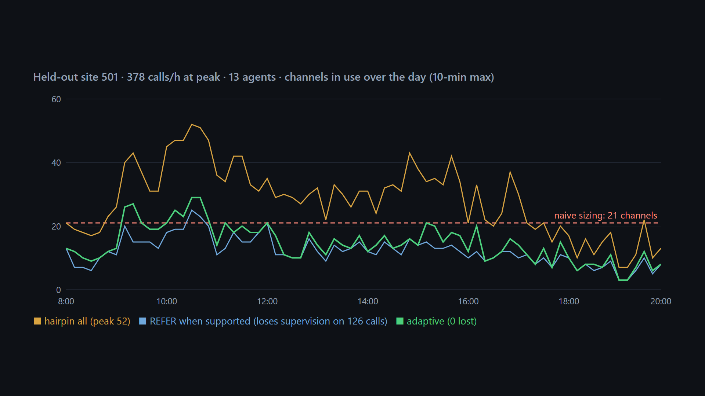

# How many SIP trunk channels does an AI agent on an on-prem PBX really need?

Unofficial prototype by Kushagra Pratap Singh. Not affiliated with Callab AI.

## The problem

[Callab](https://callab.ai) puts AI voice agents on the phone systems contact centers already run (Avaya, Cisco UCM, Mitel) over a SIP trunk, with no migration and live human supervision. On-prem means a **fixed, licensed number of trunk channels**, and they are shared by every call the AI takes and every call it hands back to people.

How the handoff is done changes the channel bill:

- **REFER** (RFC 3515): the PBX takes the call back, and the AI's channel frees at once. Context can travel in a UUI header, but the AI can't supervise the human leg. It also depends on the trunk being configured to accept REFER.
- **Hairpin / bridge**: the AI opens a second leg into the PBX queue and stays in the media path. That's **2 channels held through the whole queue wait and the human conversation**. It's the only way to keep supervising, whispering context, or recording.

Size the trunk the obvious way (Erlang B on AI talk time) and hairpinned transfers turn into busy signals at the Monday-morning peak.



## What I built (stdlib only)

- **`trunk/sim.py`**: an event simulation of one business day: hourly Poisson arrivals, a trunk with N channels (a call is blocked when it's full), AI handle time, containment, transfers by REFER / hairpin / callback, a FIFO human queue with abandonment, and failed hairpins when no second channel is free. Validated against Erlang B: with no transfers, the simulated blocking matches the formula (test).
- **`trunk/policy.py`**:
  - `hairpin all`: always bridge (keeps supervision on every call).
  - `REFER when supported`: always hand the call back to the PBX (fewest channels, no supervision).
  - `adaptive`: REFER when the call doesn't need supervision; hairpin only when it does (complaint, VIP, compliance). Offer a callback when a hairpin would eat into channels reserved for new inbound calls, or when the agent queue is long.
- **`trunk/planner.py`**: three ways to size a trunk: naive Erlang B on AI time, a **hairpin-aware formula** (Erlang C wait, 2 channels through wait + talk), and a simulation search for the fewest channels with ≤1% peak-hour blocking and ≤1% failed transfers on 3 simulated days.

## Result: 40 held-out sites, frozen in git before the first run

| policy | channels needed vs naive sizing | peak-hour blocking if sized naively (avg / worst) | supervision lost per day |
|---|---|---|---|
| hairpin all | 2.38× | 29.6% / 46.3% | 0 |
| REFER when supported | 1.50× | 9.8% / 40.1% | 84.5 |
| **adaptive** | **1.65×** | 10.6% / 32.9% | **0** |

- Sizing on AI talk time alone under-provisions badly whenever transfers are bridged. Hairpin-all needs 2.4× the naive channel count.
- **Adaptive needs 29% fewer channels than hairpin-all and never drops supervision.** The saving comes from the trunk accepting REFER: **41%** on the 27 sites where it does, only **5%** on the 13 where it doesn't. There, callbacks are the only lever (10.5/day).
- The hairpin-aware formula is within **19%** of the simulated need on average (it over-sizes some busy sites, e.g. 72 vs 50 at site 501), so it's good for a first quote and the simulation is for the final number.

Site 501 (`python demo.py`): peak 378 calls/h, 13 agents. Naive sizing gives 21 channels → 35% of peak-hour calls blocked and 126 failed transfers with hairpin-all. It needs 50 channels hairpinned, 23 with REFER (losing supervision on 126 calls), or 26 adaptive.

**Honest limits**
- Every rate is invented (arrivals, containment, handle times, patience, which calls need supervision). Nothing is Callab data, and the adaptive policy's two knobs (12% reserve, 90 s queue threshold) were not tuned.
- REFER/UUI support varies by PBX, release and trunk configuration. `refer_ok` is a per-site flag here, not a model of Avaya/Cisco/Mitel behavior.
- Callbacks are assumed to be handled by humans from the PBX with no trunk use, and 60% of callers accept one.
- Held-out was run once (`out/heldout_first_run_stdout.txt`). The trace option for the demo chart was added afterwards and doesn't change results.

## Run it

```
python demo.py                    # site 501 at naive sizing + channels each policy needs
python evaluate.py heldout        # full table (~1 min)
python -m unittest discover -s tests
```
